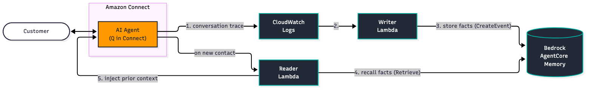

# Cross-contact recall for Amazon Connect AI agents with Amazon Bedrock AgentCore Memory

This AWS CDK (Python) sample gives Amazon Connect AI agents memory across contacts. What a
customer tells the AI agent in one conversation becomes context for the AI agent in the
customer's next conversation, using Amazon Bedrock AgentCore Memory.

The write path reads the AI agent trace events that Amazon Connect already writes to
CloudWatch Logs, so capturing conversations needs no flow change. The read path is one
Lambda block in the contact flow and one variable in the AI agent prompt.

> **Important:** This is sample code for learning and experimentation, not a
> production-ready solution. Review [Security](#security),
> [Data considerations](#data-considerations) and [Known limitations](#known-limitations)
> before you use it with real customer data.

## Architecture



1. The AI agent writes conversation trace events to its CloudWatch Logs group
   `/aws/connect/ai-agent/<instance-alias>`.
2. A subscription filter invokes the **writer Lambda**. It keeps only customer and AI
   agent turns, resolves the contact's `customerProfileId` attribute and writes the
   conversation with `CreateEvent` (actor = Customer Profiles profile id, session =
   contact id). A DynamoDB table deduplicates redelivered batches; failed batches go to
   an SQS dead-letter queue.
3. AgentCore Memory extracts long-term records asynchronously: durable facts
   (`connect/profile/<id>/semantic`), a recap per contact (`connect/profile/<id>/recap`)
   and a summary per contact (`connect/profile/<id>/summary/<contact-id>`).
4. On the next contact, the flow invokes the **reader Lambda**. It retrieves the semantic
   and recap records in parallel within a 3.5 second budget.
5. The reader writes the records, framed as untrusted data, into the AI agent session
   with `UpdateSessionData`. The AI agent prompt references them as
   `{{$.Custom.MemoryContext}}`.

Two CDK stacks deploy the Lambdas and their resources. The memory resource is created by
`scripts/provision_memory.sh`, outside CDK, so `cdk destroy` can never delete customer
data. See [docs/architecture.md](docs/architecture.md) for the design.

## Prerequisites

- An Amazon Connect instance with an AI agent for chat, with AI agent logging enabled
  (instance attribute `AUTOMATED_INTERACTION_LOG`), and the log group
  `/aws/connect/ai-agent/<instance-alias>`
- Customer Profiles enabled on the instance, and a contact flow that can look customers
  up on a verified identifier (see [docs/connect-flow-instructions.md](docs/connect-flow-instructions.md))
- A free subscription filter slot on the AI agent log group (`scripts/preflight.py` checks this)
- The AWS CDK bootstrapped in the target account and Region
- Python 3.12, the AWS CDK CLI v2 and the AWS CLI v2, with credentials for the account

## Quick start

```bash
git clone https://github.com/aws-samples/sample-amazon-connect-agentcore-memory-cdk.git
cd sample-amazon-connect-agentcore-memory-cdk
python3 -m venv .venv && source .venv/bin/activate
pip install -r requirements.txt -r requirements-dev.txt

AWS_REGION_OVERRIDE=<region> AWS_PROFILE_OVERRIDE=<aws-profile> ./scripts/provision_memory.sh
# Copy the printed memory ARN and your instance values into cdk.json (see Configuration).
python3 scripts/preflight.py --profile <aws-profile>
./scripts/bundle_lambdas.sh
cdk deploy --all --profile <aws-profile>
```

Then apply the flow and prompt changes in
[docs/connect-flow-instructions.md](docs/connect-flow-instructions.md). The
[deployment guide](docs/deployment-guide.md) covers every step, verification and
troubleshooting.

## Configuration

All deployment values live in the `context` block of `cdk.json`, or are passed with
`-c key=value`. `app.py` validates them at synth time and fails on a missing value, an
unreplaced `REPLACE_WITH_...` placeholder or a value of the wrong shape.

| Key | Description |
|---|---|
| `connectInstanceId` | Amazon Connect instance id (UUID, not the ARN) |
| `connectInstanceAlias` | Instance alias |
| `aiAgentLogGroupName` | `/aws/connect/ai-agent/<instance-alias>` |
| `memoryResourceArn` | AgentCore Memory ARN printed by `scripts/provision_memory.sh` |
| `wisdomAssistantArn` | AI agent assistant ARN (`arn:aws:wisdom:<region>:<account>:assistant/<id>`) |
| `wisdomAssistantId` | AI agent assistant id |
| `accountId` / `region` | Target account and Region |

## Data considerations

The sample stores parts of customer conversations. Decide whether that is acceptable for
your use case, and with which notice and consent, before you deploy it. Customers can
mention regulated data, such as health information, in a conversation; the sample does
not filter it.

**What is stored**

| Store | Content | Retention |
|---|---|---|
| AgentCore Memory raw events | Customer and AI agent turns (no reasoning, no tool input or output), per contact | 90 days (`MEMORY_EVENT_EXPIRY_DAYS`) |
| AgentCore Memory long-term records | Extracted facts, recaps and summaries per customer | Until deleted |
| DynamoDB dedup table | Orchestration ids (or AI agent session ids) only | 90-day TTL |
| SQS dead-letter queue | Failed write batches, which contain conversation text | 14 days |
| Lambda log groups | Profile ids, contact ids and outcomes, no conversation text | 1 month |

**Deletion.** To delete everything the memory resource holds for one customer (raw events
and all long-term records), run:

```bash
python3 scripts/cleanup_memory.py --memory-id <memory-id> --region <region> \
  --aws-profile <aws-profile> --profile-id <customer-profile-id>
```

The script verifies that nothing is left and exits non-zero otherwise. See
[docs/teardown.md](docs/teardown.md) for details and for deleting the whole resource.

**Encryption.** AgentCore Memory, DynamoDB and SQS encrypt data at rest with AWS managed
keys; all API calls use TLS. For customer managed keys, set `encryptionKeyArn` when you
create the memory resource.

## Security

- **Identity is bound in the flow.** Both Lambdas trust the contact attribute
  `customerProfileId`. The flow must clear it at flow start (set it to `none`), set it
  from `$.Customer.ProfileId` only after a **Get profile** match on a verified
  identifier, and leave it cleared on the None Found, Multiple Found and Error branches. Never bind memory
  on a value the customer types. Otherwise one customer's memory can be read to another
  customer. Contacts without a valid profile id are skipped on both paths.
- **Memory is untrusted input.** Stored records come from what customers said. The reader
  wraps them in a `<customer_memory>` block marked as untrusted data, strips the delimiter
  tags from record text and caps the block at 2,000 characters. The prompt guidance tells
  the AI agent not to follow instructions inside it.
- **Memory text stays out of the contact record.** The reader returns only flags to the
  flow; the text reaches the AI agent only through `UpdateSessionData`.
- **Least privilege.** Each Lambda has its own role with resource-scoped statements:
  `CreateEvent` and `RetrieveMemoryRecords` on the one memory ARN, `GetSession` and
  `UpdateSessionData` on sessions of one assistant, `GetContactAttributes` on one
  instance, log writes to the function's own log group. Invoke permissions are limited
  to the CloudWatch Logs and Connect service principals with a source ARN.
- **No public endpoint.** No API, no Function URL, no VPC.
- **Pinned dependencies.** The Lambda bundles install hash-locked requirements.
- **cdk-nag.** `AwsSolutionsChecks` runs on every synth; each suppression has a reason.

**Before production**

- Add filtering before `CreateEvent`, for example Amazon Bedrock Guardrails
  (`ApplyGuardrail`) or redaction, to keep sensitive or manipulative content out of memory.
- Scope the memory execution role in `scripts/provision_memory.sh` to your extraction
  model and inference profile; the sample allows any foundation model and inference profile.
- Use customer managed KMS keys, enable CloudTrail for `bedrock-agentcore`, and review
  log retention and the logging of profile ids.

## Cost

The Lambda, DynamoDB (on demand), SQS and CloudWatch Logs subscription costs are small at
low volume. The main cost is AgentCore Memory: events stored, records extracted (which
invokes the extraction model) and retrieval calls. Check
[Amazon Bedrock AgentCore pricing](https://aws.amazon.com/bedrock/agentcore/pricing/)
for your Region and volume.

## Known limitations

- Memory is written after the AI agent responds and extracted asynchronously, so facts
  from the contact in progress are not recalled during that contact.
- The reader queries the semantic and recap namespaces at contact start with a fixed
  search query. It does not query the per-contact summaries, whose namespace contains the
  contact id.
- Only contacts with a bound `customerProfileId` get memory; anonymous contacts are skipped.
- Each flow that should use memory needs its own Lambda block and prompt change.
- One memory resource per account and Region; there is no cross-Region sharing.

## Teardown

```bash
cdk destroy --all --profile <aws-profile>
```

This keeps the memory resource, its execution role and the DynamoDB dedup table (retained
on purpose). Remove the reader Lambda block from your flows first. See
[docs/teardown.md](docs/teardown.md) for the complete cleanup.

## Testing

```bash
python3 -m pytest   # or: make test
```

The unit tests run against fakes, with no AWS calls: parsing, identity resolution, dedup,
the writer and reader logic, both Lambda handlers, the deletion script and the
synthesized CloudFormation templates.

## Repository layout

```
app.py                 CDK app; reads and validates cdk.json context
stacks/                MemoryWriterStack and MemoryReaderStack
src/connect_memory/    Shared modules: parser, identity, writer, reader, dedup
lambdas/               Writer and reader Lambda handlers and their locked requirements
scripts/               provision_memory.sh, preflight.py, bundle_lambdas.sh, cleanup_memory.py
tests/                 Unit and CDK stack tests
docs/                  Architecture, deployment guide, flow instructions, teardown
```

## Security reporting

See [CONTRIBUTING](CONTRIBUTING.md#security-issue-notifications) for more information.

## License

This library is licensed under the MIT-0 License. See the [LICENSE](LICENSE) file.
